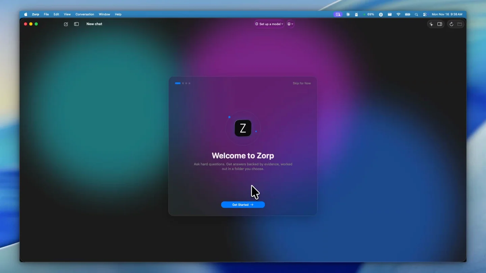
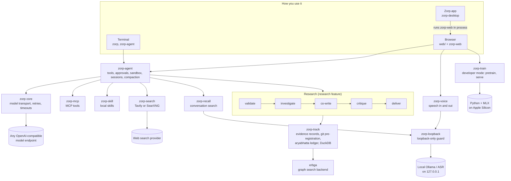

<div align="center">

# zorp



### Own your intelligence.

**Everyone rents intelligence by the token. What if you owned the whole stack?**

Run any open-weight model on your own hardware. Give it memory, evaluate it,
serve it fast, or train your own. Get to discoveries faster, with an
evidence-backed research agent underneath.

*Own the model. Own the stack.*

**19 pieces ship today** · **131,825 lines, open source** · **MIT licensed, end to end**

<br/>

[](https://github.com/aviskaar/zorp/actions/workflows/ci.yml)
[](LICENSE)
[](https://www.rust-lang.org)
[](#status-and-roadmap)
[](https://github.com/aviskaar)
[](docs/RELEASING.md#reading-download-counts)
[](docs/RELEASING.md#reading-download-counts)

**[Download for Mac (.dmg)](https://github.com/aviskaar/zorp/releases/download/v0.8.1/Zorp-v0.8.1-universal.dmg)** · [Windows](https://github.com/aviskaar/zorp/releases/download/v0.8.1/zorp-v0.8.1-x86_64-pc-windows-msvc.zip) · [Linux x86_64](https://github.com/aviskaar/zorp/releases/download/v0.8.1/zorp-v0.8.1-x86_64-unknown-linux-gnu.tar.gz) · [Linux arm64](https://github.com/aviskaar/zorp/releases/download/v0.8.1/zorp-v0.8.1-aarch64-unknown-linux-gnu.tar.gz)

**[zorp.dev](https://zorp.dev)** · [Docs](https://docs.zorp.dev) · [v0.8.1 release notes](https://github.com/aviskaar/zorp/releases/tag/v0.8.1) · [Q&A](https://github.com/aviskaar/zorp/discussions/categories/q-a) · [Contact](../../issues)

</div>

---

Or install the CLI from a terminal (macOS and Linux, x86_64 and arm64):

```bash
curl -fsSL https://raw.githubusercontent.com/aviskaar/zorp/main/install.sh | bash
```

> **Status: pre-alpha.** Not ready for production. Anything that is not
> built yet is marked planned below. See [Status and roadmap](#status-and-roadmap).

## Contents

[Everything in the stack](#everything-in-the-stack) ·
[The stack](#the-stack) ·
[Why own it](#why-own-it) ·
[For answers that must hold up](#for-answers-that-must-hold-up) ·
[Questions](#questions) ·
[Quick start](#quick-start) ·
[Architecture](#architecture) ·
[Guides](#what-you-can-do-with-it) ·
[Repository layout](#repository-layout) ·
[Development](#development) ·
[Status and roadmap](#status-and-roadmap) ·
[Origins](#origins) ·
[Contributing](#contributing) ·
[License](#license)

## Everything in the stack

One open-source project, from the chat window down to training your own
model.

| Use it | Investigate | Know | Measure | Train |
|---|---|---|---|---|
| Terminal agent | Validate | Local memory | Harness eval suite | Pretraining |
| Browser chat | Investigate | Web search | Public benchmarks | Serve your checkpoint |
| Mac app | Co-write | Skills | [BudgetBench](https://github.com/aviskaar/budgetbench) | Fine-tuning *(planned)* |
| | Deliver | Voice input | | RLStudio post-training *(planned)* |
| | Critique gate | MCP tools | | |
| | Panel review | | | |

## The stack

One harness runs any open model. Everything else sits on top of it.

| Layer | What it does | Status | Crates | Lines |
|---|---|---|---|---|
| **Interface** | The terminal agent, the browser chat with the artifact beside it, and the Mac app. | Built | `zorp-web`, `web`, `zorp-desktop` | 39,141 |
| **Investigate** | The research agent: tracks, the Kill Threshold, the evidence record, and the aryabhatta discovery layer. | Built | `zorp-track`, `erbga` | 17,266 |
| **Evaluate** | The harness suite that gates every change, compatibility runs and public benchmarks. BudgetBench lives in its own repository. | Built | `zorp-eval` | 7,201 |
| **Memory** | Local recall and memory over your own conversations. Text goes to a loopback address or nowhere. | Built | `zorp-recall`, `zorp-loopback` | 2,800 |
| **Adapt and train** | Pretraining in developer mode on Apple Metal through MLX today. Fine-tuning and RLStudio post-training are planned. | Partial | `zorp-train` | 3,026 |
| **Tools** | Web search through Tavily or your own SearXNG, Claude Code compatible skills, and local voice. | Built | `zorp-search`, `zorp-skill`, `zorp-voice` | 4,516 |
| **Harness** | The core and the agent: any OpenAI-compatible model, tools, approvals, sessions and MCP, in one CLI and API. | Built | `zorp`, `zorp-agent`, `zorp-mcp`, `zorp-stub` | 57,875 |
| **The model** | Any open-weight model, or one you build. Swap it and nothing above it changes. | | | |
| **Your hardware** | Your laptop, your workstation, your servers. Offline if you want it to be. | | | |

Line counts: Rust, TypeScript and Python per crate at commit `16a773e`, counted with `wc -l`, generated and vendored files excluded.

## Why own it

**The market is built to rent you intelligence, not to help you own it.**
The default path is a frontier API: easy to start, metered by the token,
and every call sends your data out of the building. The meter never stops,
your context leaves, and one vendor owns the price, the limits and the
model.

**The models got good, and the tooling grew up.** Small open-weight models
clear the bar for most everyday work (classification, extraction, routing,
drafting), and serving, memory, tuning and evaluation are now building
blocks you can own.

**Hybrid by design.** The question is not open versus closed. It is which
workload runs where. Keep the work local unless it is beyond a local model
and the data is safe to send out. Sensitive data stays home however hard
the task.

**You are not buying a model. You are owning an interchangeable stack.**
Swap in a better open model when one ships. Nothing above it changes.

**Give it a memory that stays home.** A model with no memory starts cold
every time. zorp indexes your past conversations on your machine and
quotes the relevant ones back: earlier conversations, a local index
(SQLite and local embeddings), quoted into the turn, so the model starts
warm. There is no remote embedding provider and no fallback to one.

**Run it, adapt it, or train your own.** Run open weights as they are, or
pretrain a tokenizer and a model from scratch on Apple Metal. Fine-tuning
and RLStudio post-training are planned. The data that adapts or trains the model
never leaves your machine to do it.

**Prove it holds up.** A leaderboard will not tell you if a small model
clears your bar. Test it under the token, context and memory budget you
will actually run with. Budget-tiered evaluation is formalized in
[BudgetBench](https://github.com/aviskaar/budgetbench) (Rao and Jaggi,
arXiv 2609.13149).

**Serve it fast.** Any OpenAI-compatible server works, so a quantized model
on Ollama, LM Studio or vLLM becomes your endpoint. No round trip to
someone else's data center.

**An agent you run offline cannot leak what it never sends.** It reaches
only what your machine exposes, tool calls pass approval rules you set and
are stored with the conversation, and web search is off until you turn it
on. See the [threat model](docs/THREAT_MODEL.md).

## For answers that must hold up

*Answers are cheap. Evidence is not.*

Stop asking for an answer. Ask for an investigation. A prompt gives you a
fluent answer in seconds and keeps nothing. An investigation goes from
question to registered intent, sources, evidence, checkpoint and answer,
and every claim traces back to a record someone who was not there can
check.

**Commit before you look.** The hypothesis, the metric and a Kill
Threshold, the number that would prove the investigation wrong, are
written to a file, hashed and committed to git before any evidence
exists. Only a person sets the threshold, and only a person can move it.
Every attempt is recorded, not just the one that worked.

**Measured, not claimed.** Each forecast is recorded before its attempt
runs, so it cannot be a postdiction, and zorp checks whether the agent's
stated confidence means anything.

The research agent runs as four capabilities, validate, investigate,
co-write and deliver, with `critique` as a gate between co-write and
deliver that audits the draft against the evidence record in code. A
human is always the author of record. See
[Research capabilities](docs/research.md) and
[zorp.dev/research](https://zorp.dev/research/).

## Questions

**What is zorp?** An open-source stack for running open-weight models on
your own hardware. A terminal agent, a browser chat and a Mac app sit on
one harness, with memory, evaluation, serving and a research agent on top.

**Which models does it work with?** Any OpenAI-compatible server. A
quantized model on Ollama, LM Studio or vLLM becomes your endpoint, and a
hosted provider works too when you choose to send work out.

**Does anything leave my machine?** Not unless you send it. With a local
model nothing leaves the machine, and memory text goes to a loopback
address or nowhere. See [Network egress](docs/NETWORK_EGRESS.md).

**Which systems does it run on?** macOS, as a universal desktop app or the
CLI; Linux on x86_64 and arm64; and Windows on x86_64, where the agent
runs commands under Git Bash.

**Is it free?** Yes. zorp is open source under the MIT license. You pay
for your hardware and its power, not for tokens.

**Is it ready for production?** No. zorp is pre-alpha.

## Quick start

Install prebuilt `zorp`, `zorp-agent` and `zorp-web` binaries (Linux and
macOS, x86_64 and arm64):

```bash
curl -fsSL https://raw.githubusercontent.com/aviskaar/zorp/main/install.sh | bash
```

Point zorp at a model. Any OpenAI-compatible endpoint works, including a
local one (Ollama, LM Studio, vLLM):

```bash
export ZORP_BASE_URL="https://api.openai.com/v1"
export ZORP_API_KEY="sk-..."
export ZORP_MODEL="gpt-4o-mini"
```

Then use it from the terminal or the browser:

```bash
zorp-agent "<task>"                      # the agent, in the terminal
zorp-web --workspace ~/research          # the chat UI on http://127.0.0.1:7777
```

On a Mac you can instead download `Zorp-v<version>-universal.dmg` from the
latest GitHub release and drag `Zorp.app` to `/Applications`.

On Windows, download `zorp-v<version>-x86_64-pc-windows-msvc.zip` from the
latest release, unzip it, and put the folder on your `PATH`. zorp runs the
agent's commands under Git Bash, so install
[Git for Windows](https://git-scm.com/download/win) first, or set `ZORP_SH`
to the `sh.exe` you want. The desktop app is Mac only.

To build from source, run from Docker, or tune timeouts and retries, see
[Getting started](docs/getting-started.md). The four research capabilities
need a source build with the `research` feature.

## Architecture

Three surfaces share one agent, one session store and one settings file.
Everything below the agent is a separate crate, so each piece can be
tested on its own.



Two boundaries matter most. Conversation text and recorded voice only
ever go to a loopback address, enforced in `zorp-loopback`. And no model
can start an investigation, a panel, a training run or a memory pass:
those are launched by a person. The [threat model](docs/THREAT_MODEL.md)
covers the rest. Testing sits beside all of this: `zorp-eval` runs the
real binary against `zorp-stub`, a scripted model on loopback.

## What you can do with it

| Guide | What it covers |
|---|---|
| [Getting started](docs/getting-started.md) | Building from source, the install script, `Zorp.app`, Docker, timeout and retry settings |
| [Research capabilities](docs/research.md) | Running validate, investigate, co-write and deliver; connecting MCP search tools; memory with open-context; built-in web search |
| [Web UI](docs/web-ui.md) | The browser chat: workspaces, choosing a model, voice input, streaming answers, the Files pane, running it in containers |
| [Recall and memory](docs/recall-and-memory.md) | Searching your own conversations, and quoting earlier ones into a new turn, on this machine only |
| [Skills](docs/skills.md) | Using Claude Code compatible skills, and what a skill can and cannot do |
| [Docker](docs/docker.md) | The container image and the compose stack in detail |
| [Benchmarks](docs/benchmarks.md) | Running zorp-agent against Terminal-Bench |
| [Threat model](docs/THREAT_MODEL.md) | What is stored and where, what leaves the machine and when, how credentials, approvals and the sandbox work, and the known gaps |
| [Network egress](docs/NETWORK_EGRESS.md) | What each workflow connects to, by procedure and observed destination, marked expected, optional or prohibited |
| [Sandbox test matrix](docs/SANDBOX_TEST_MATRIX.md) | Each `srt` mode against the attack vectors it is meant to stop, with what was observed, what was not, and the remediation |
| [Decision log](docs/DECISIONS.md) | Why things are the way they are |

## Repository layout

```
.
├── src/                 # zorp core crate: model transport, raw primitives (binary: zorp)
├── zorp-agent/          # the agent: tools, reasoning, verification, sessions, MCP, telemetry
├── zorp-web/            # the browser chat server (binary: zorp-web)
├── web/                 # the browser UI, TypeScript
├── zorp-desktop/        # Zorp.app, the native Mac app (outside the Cargo workspace)
├── zorp-mcp/            # MCP client/server integration
├── zorp-track/          # research foundation: tracks, evidence records, pre-registration, checkpoints
├── zorp-eval/           # evaluation: compat, the gating harness suite, and bench
├── zorp-stub/           # scripted model provider used by tests and the harness suite
├── zorp-search/         # web search providers (Tavily, SearXNG)
├── zorp-skill/          # Claude Code compatible skill discovery and parsing
├── zorp-recall/         # local conversation search
├── zorp-voice/          # local voice transcription client
├── zorp-train/          # developer mode: local pretraining
├── erbga/               # standalone genetic algorithm for graph community detection
├── evals/               # eval suites (smoke tests, Terminal-Bench, Harbor adapter)
├── examples/            # usage examples (e.g. OpenTelemetry tracing)
├── docs-site/           # the documentation site
├── docs/
│   ├── paper/           # arXiv writeup (WIP)
│   ├── superpowers/     # zorp's own design specs and plans
│   └── upstream-quecto/ # preserved history of the upstream harness (see Origins)
└── reference/           # gitignored, local-only research material, not distributed
```

## Development

```bash
cargo build --workspace --exclude zorp-track   # fast path, see docs/getting-started.md
cargo test --workspace --exclude zorp-track    # matches CI; see CONTRIBUTING.md for full coverage
cargo run -p zorp-eval -- --help               # evaluation harness
```

To run zorp-agent against Terminal-Bench, see
[`docs/benchmarks.md`](docs/benchmarks.md).

Working in this repo? Read [`CLAUDE.md`](CLAUDE.md) and [`AGENTS.md`](AGENTS.md)
first. They cover the inherited vs. zorp-specific code boundary, where
design specs live, and repo conventions.

## Status and roadmap

- [x] Base execution harness (forked from quecto, renamed, fully tested)
- [x] Research foundation (`zorp-track`: multi-track evidence records, git-backed pre-registration, checkpoints, DuckDB)
- [x] **validate**: is this question worth investigating (novelty and feasibility check)
- [x] **investigate**: gather evidence through staged, pre-registered attempts, every attempt recorded
- [x] **co-write**: zorp drafts the artifact, a human is always the author of record
- [x] **deliver**: match a finished draft against real academic venues (conferences and journals, via live huiban search), writing a ranked shortlist for a human to review
- [ ] A published investigation trace, start to finish
- [ ] A grounded-vs-baseline evaluation
- [ ] A systems paper about zorp itself, submitted to arXiv

### Where this is going: own your intelligence

zorp is free, local first AI you own: your models, your files, your
machine. The next step is **RLStudio**, the training side, where models
are retrained and post-trained on how you actually use them. It covers
the full stack, and closes it into a loop:

```
pretrain ─▶ fine-tune ─▶ use in zorp ─▶ observe ─▶ RLStudio self-trains
               ▲                                          │
               └──────────────────────────────────────────┘
```

Pretrain a model, use it in zorp, and feed the logs from
that use back to RLStudio, which trains on the new data and returns a
better model. Each pass fits the model more closely to one person's or
one team's usage patterns, and because the loop is meant to run on your
own hardware, those logs are meant to stay there too.

Part of this is built and part is direction. What exists today:

- [x] **Pretrain**: developer mode (`zorp-train`) trains a BPE tokenizer and a Qwen style model from scratch on Apple Metal through MLX
- [x] **Use it in zorp**: a finished checkpoint is served on loopback and shows up in the model picker ("Open in Zorp")
- [ ] **Observe**: record thumbs, a better answer you typed, and tool status derived in code in a local work log, and turn them into training sets in code. The model never grades itself
- [ ] **Fine-tune**: post-train an existing open model on a dataset built from that work log
- [ ] **RLStudio post-training**: reinforcement learning on that feedback
- [ ] **Automated training**: retrain on new data without being asked, and keep a new model only when it measures better than the one it would replace

## Origins

zorp's execution layer started as a fork of
[quecto](https://github.com/adityak74/quecto), a minimal, vendor-neutral
harness for LLM agents (MIT licensed). See [`NOTICE.md`](NOTICE.md) for
full attribution. We modify and extend it directly rather than depending
on it as an external crate, since zorp's needs (long-running research
loops, experiment tracking, paper synthesis) diverge substantially from a
general agent harness. Crates and binaries have been renamed from
`quecto-*` to `zorp-*`. [`docs/UPSTREAM_QUECTO_README.md`](docs/UPSTREAM_QUECTO_README.md)
and [`docs/upstream-quecto/`](docs/upstream-quecto/) preserve the original
project's documentation and design history for reference.

## Contributing

Contributions are welcome. zorp is early and still moving fast, so it's
worth opening an issue to discuss larger changes before sending a PR.
See [`CONTRIBUTING.md`](CONTRIBUTING.md) for setup, testing, and PR
guidelines, and [`CODE_OF_CONDUCT.md`](CODE_OF_CONDUCT.md) for community
expectations.

Questions and discussion: [Discussions › Q&A](https://github.com/aviskaar/zorp/discussions/categories/q-a).

## License

MIT. See [`LICENSE`](LICENSE) and [`NOTICE.md`](NOTICE.md) for third-party
attribution.
